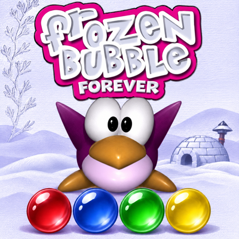

# Frozen Bubble Forever

Frozen Bubble in WoW Forever: the original 100 levels, two-player versus, community highscores, and player-created levels. Native Lua; no external service or runtime dependencies.

**Alpha software.** The Lua simulation, protocol, UI loading, and packaging have automated tests. Live Forever client testing is still required, particularly for addon-message restrictions and channel reach. This is an adaptation of the game, not a bit-for-bit port of its Perl/SDL runtime or its five-player internet server.

## Install and play

Download `FrozenBubbleForever-<version>.zip` from [GitHub Releases](https://github.com/cyberbalsa/frozenbubblewow/releases), extract it into `World of Warcraft/_forever_/Interface/AddOns/`, and restart WoW. The resulting file must be `Interface/AddOns/FrozenBubble/FrozenBubble.toc`.

Type `/fb`. Aim with the mouse and click to fire. While the pointer is over the board, Left/Right or A/D aim; Space/Up fire; P pauses solo games. Match three of the same color and drop clusters disconnected from the ceiling. The ceiling descends every nine solo shots and the launcher fires after 10.5 seconds in solo play.

- **Campaign:** 100 original layouts with level unlocks and saved checkpoints. Runs started at level 1 qualify for campaign highscores. Restarting a partially played board after logout becomes practice.
- **Endless:** clear the board for a new wave and a 500-point bonus.
- **Versus:** both players start with the same board. Falling clusters cancel incoming garbage first, then attack the opponent. Clear your board or survive longer to win. No pause; hiding the window leaves the match running. Timeout or combat cancels the match without a result.
- **Editor:** paint up to ten rows, test, save, import/export a 98-character layout code, and publish to the community. Saved/imported levels are unranked.

## Community channel and P2P sharing

Open Multiplayer and join `FrozenBubbleForever`. This dedicated in-game channel carries queue advertisements, highscores, and level listings. Direct addon whispers carry match state and requested level data. No guild membership is required when using the community channel. Without it, discovery falls back to your guild/group.

The addon probes channel delivery instead of treating a successful API return as proof of delivery. If the probe fails, it shows manual mode. **Announce queue**, **Share my best**, **Browse community**, and **Publish** send normal channel discovery packets from your click. These are visible text messages in the dedicated channel; the addon does not post to General or Trade, or automate protected normal chat sends. Recipients with the addon parse them into the lobby/library. Normal chat announcements are rate-limited to one per two seconds. Automatic addon traffic is bounded and throttled.

**Channel scope is a client/server limitation.** Developers have reported blocked custom-channel addon messages and separate channel visibility across Forever's internal servers. Sharing a ruleset does not guarantee that two players can see each other. A direct Player-Realm challenge may work when public discovery does not. These limitations cannot be fixed by changing an addon.

The marketplace is a free exchange, with no currency or payment flow. A creator marks a level public; other players browse listings and request its layout directly. Creators must be online. Downloads are validated, stored locally, and may be explicitly republished by recipients. At most 100 saved levels, 200 live listings, and ten listings per catalog response are retained/returned. Listings expire after three minutes; requests time out after 12 seconds. Layouts are data, never executable code.

Highscores are personal or cached community reports, not a server-verified global ranking. Player names come from WoW's message sender, but another addon or a modified client can fabricate its own score. Match state is also peer-reported; this is friendly competition, not a cheat-proof ladder.

## Debugging

`/fb debug` prints the last twelve log entries. `on`, `off`, `clear`, and `errors` enable/disable logging, clear it, or enable WoW Lua error popups. Logging is enabled by default in this alpha and retains 500 entries. It records addon errors, delivery results, match transitions, and level transfers. It does not contain publishing credentials.

WoW saves `FrozenBubbleDB`, including `debugLog`, to `WTF/Account/<account>/SavedVariables/FrozenBubble.lua` on logout or `/reload`. A client crash before saving can lose recent entries. See [the live test checklist](docs/TESTING.md).

## Development and releases

Run `lua5.1 tests/run.lua` and `python3 tests/package_test.py`. `python3 tools/package.py v0.1.0-alpha.1` builds a deterministic ZIP and SHA-256 checksum in `dist/`. Runtime files live in `FrozenBubble/` and load in TOC order. Python and Pillow are needed only to regenerate artwork; Python packaging itself has no third-party dependencies.

GitHub Actions tests Lua 5.1 and 5.4 on every push/PR, packages the addon, and retains a build artifact. A `v*` tag creates a GitHub Release and uploads the same ZIP to CurseForge project **1815958** after tests pass. The workflow verifies that the configured CurseForge game version matches interface 16001 before uploading. Alpha/beta tags set the corresponding CurseForge release type.

Repository configuration:

- Secret `CF_API_TOKEN`: CurseForge author upload token.
- Variable `CF_PROJECT_ID`: `1815958`.
- Variable `CF_GAME_VERSION_ID`: `17053` (Forever 1.60.1, interface 16001).

For local publishing, keep the token outside the checkout in `~/.config/frozenbubblewow/curseforge-token` with mode 0600. Pass its path through `--token-file` to `tools/curseforge_upload.py`; use `--check` to verify without uploading. Never commit a token. The GitHub workflow uses its own repository token for releases.

Original game source, license, attribution, and reproducible asset conversions are documented in [THIRD_PARTY.md](THIRD_PARTY.md). This port is GPL-2.0-only.
